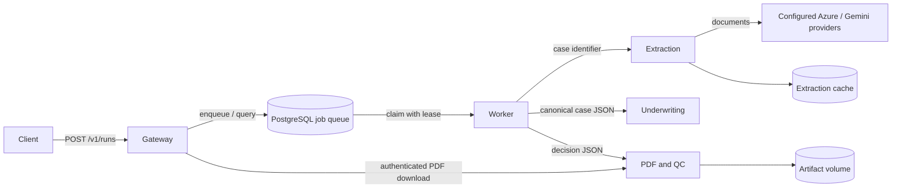

# Underwriting service architecture

The application is a modular monorepo with four independently runnable HTTP
services and a dedicated workflow worker. Services communicate through versioned
JSON contracts. The existing extraction agents and carrier rules remain the
policy kernel; HTTP handlers contain no underwriting rules.



| Component | Owns | Runtime access |
|---|---|---|
| Gateway | Public run submission, status and download API | Queue DB and artifact API; client token |
| Worker | Leases, stage checkpoints, bounded retry and orchestration | Queue DB and three private service APIs |
| Extraction | Survey, agents, reconciliation and identity verification | Read-only cases/references, extraction cache and provider credentials |
| Underwriting | Carrier routing, eligibility gates, calculations and verdict | Packaged rule configuration; no provider credentials |
| Artifacts | Case-sheet rendering, QC and download gate | Its own writable artifact volume |

Only the gateway publishes a host port, bound to localhost. The backend network
is private. Extraction has a separate egress network for configured providers.
Each service runs as a non-root user with a read-only container filesystem;
writable state lives in named volumes. Shared bearer authentication is appropriate
for this local deployment. An externally exposed deployment must replace it with
tenant-aware authorization, managed secrets and TLS at an ingress boundary.

## Source layout

All Python packages live under `src/underwriting_platform/`; see [LAYOUT.md](LAYOUT.md).
Configuration is centralized, routing and required gate names are shared domain
definitions, and `infrastructure/delivery.py` is the single CLI/service delivery
boundary. Canonical validation is independent of the versioned outer envelope.
See [release hardening](HARDENING.md) for cache dependencies and checkpoint storage.

Production is blocked pending the [security, lifecycle and scaling prerequisites](PRODUCTION_PREREQUISITES.md).
Shared bearer tokens provide neither tenant isolation nor user authorization.
Artifacts import frozen snapshots through the authenticated internal evidence API
into their own storage; they do not share the extraction volume. Run
extraction/artifacts with one replica and one process; worker count is not capacity.
Job submissions require a nonblank Idempotency-Key reused across client retries.

## Start the local services

From the Git checkout root, copy `.services.env.example` to `.services.env`. Replace its
three password/token placeholders with separate random URL-safe values. Set the
case and reference directories and the extraction provider env-file path. The
repository `.env` is never loaded. Provider settings can instead point to Azure
Key Vault; inject ordinary configuration before process startup. Production
secrets should come from managed identity/Key Vault or deployment secret injection.

```powershell
Copy-Item .services.env.example .services.env
# Edit .services.env with your deployment values.
docker compose --env-file .services.env up --build -d --wait
docker compose --env-file .services.env ps
```

The API documentation is at `http://127.0.0.1:8000/docs`. Authorize with the
gateway bearer token. Submit a case identifier matching a directory under the
configured case root:

```http
POST /v1/runs
Authorization: Bearer <gateway-token>
Idempotency-Key: <unique-request-key>
Content-Type: application/json

{"schema_version":"1.0","case_id":"C123456789","proposed_sa":10000000}
```

Submission returns HTTP 202 and a `job_id`. Poll `GET /v1/runs/{job_id}` and
download the PDF through `GET /v1/runs/{job_id}/case-sheet`. Reusing an idempotency
key with the same request returns the same job; changing the request returns 409.
A new run intended to consume changed evidence must use a new idempotency key.

Stop with `docker compose --env-file .services.env down`. Named volumes remain
intact. Scale the worker with `--scale worker=2`; PostgreSQL uses row locking and
`SKIP LOCKED` to let workers claim different jobs. Extraction and artifact
adapters serialize work within each process. This Compose deployment has one
replica of each of those services; horizontal scaling of their file stores needs
distributed coordination or an object-storage implementation.

For development without Docker:

```powershell
python -m pip install -e ".[dev]"
$env:UW_GATEWAY_TOKEN = '<gateway-token>'
$env:UW_SERVICE_TOKEN = '<service-token>'
$env:UW_SERVICE_ROLE = 'gateway'
$env:UW_BIND_PORT = '8000'
uw-api
# In separate shells: extraction on 8001, underwriting on 8002, artifacts on 8003.
# Set UW_SERVICE_ROLE and UW_BIND_PORT accordingly, then run uw-api.
# In another shell, with matching tokens and database configuration:
uw-worker
```

Local development defaults to SQLite at the shared data root's `runtime/jobs.sqlite3`. Deployment uses
PostgreSQL. `UW_EXTRACTION_URL`, `UW_UNDERWRITING_URL`, `UW_ARTIFACTS_URL`,
`UW_DATABASE_URL`, `UW_CASE_ROOT`, `UW_ARTIFACT_ROOT`, `UW_EXTRACTION_CACHE`,
`UW_REFERENCE_ROOT` and `UW_CONFIG_ROOT` are explicit configuration boundaries.

## Workflow and failure semantics

CLI single/batch and services share `underwriting_platform.infrastructure.delivery`.
Failures in required extraction, identity verification, engine execution, input
retention, rendering, profile loading, PDF inspection or any required QC check
block delivery. Both CLI runners return exit code 1 for these failures. Explicit
QC BLOCK also blocks delivery. `--no-pdf` and `--no-engine` are diagnostics and
never produce a deliverable decision. A rerun removes prior deliverable markers
and PDFs before processing so a failure cannot expose an old approved artifact.

`delivery.json` is the release authority. A quality report with no detected BLOCK
does not prove decision completeness. Missing required typed applicant facts,
source evidence, gate evaluations or citations produce an incomplete decision.
The diagnostic engine result is retained as `*_diagnostic_decision.json`; the
usual `*_decision.json` is INCOMPLETE if release is blocked. Only successful
delivery creates `*_delivered_decision.json`. Required API downloads enforce
completion and QC; old artifacts without these records cannot be delivered.

Standard issuance additionally requires resolved identity evidence or a recorded
approval from a trusted review process. Production must authenticate reviewer
identity and authorize approvals; bearer-only POC services cannot prove this. An expected evidence gap can still support a documented
decline or further-requirement decision; an unexpected processing failure cannot.

The worker claims a job with a renewable lease and commits each completed stage
to the database. A restarted worker resumes those checkpoints. Expired leases
can be reclaimed; the old owner cannot commit. Retryable dependency failures have
a bounded attempt count (`UW_MAX_ATTEMPTS`, default 3). `UW_LEASE_SECONDS`
defaults to 60 and `UW_STAGE_TIMEOUT_SECONDS` to 1800. There is no exactly-once
claim for provider calls: a crash before an extraction response is cached can
repeat a call. Input/configuration/prompt/version fingerprints avoid reusing
cached extraction across those changes.

`succeeded` means the workflow produced a validated artifact. A business verdict
of `DECLINE` can therefore have workflow status `succeeded`. The business outcome
is always `result.verdict`. Underwriting `INCOMPLETE`/`ERROR` and QC `BLOCK` produce
workflow status `incomplete`; unexpected processing failures produce `failed`
with no issuance result. QC-blocked PDFs cannot be downloaded. Failed eligibility
gates and missing mandatory processing continue to block issuance in the kernel.

Every API validates its envelope version and case identifier. The worker rejects
responses for a different case. Invalid case identifiers cannot choose arbitrary
filesystem paths. API errors omit input payloads and exception details. New
service logs use correlation identifiers and structured status/error fields.
Checkpoints and artifacts contain sensitive case data: retention, encryption and
backup policy remain deployment responsibilities.

`/health/live` checks the API process; `/health/ready` checks its configured local
dependencies. The worker is monitored through container state and job progress;
it has no separate HTTP health endpoint. No service restart or database outage
is treated as an issuance approval.

## Verify

Every case's `reproduction/latest.json` points to a retained unique run bundle
containing normalized input, raw extraction input, exact policy assets,
effective rules, provider/model/deployment/API identifiers and content versions
for prompts, rule sets, parser and QC profile. CLI document snapshots are retained
when source files are available. These records are sensitive and need deployment
retention/encryption controls. Replay the frozen normalized input with its retained
rule assets; a new model generation is not claimed to be deterministic.

Azure Key Vault configuration (nonsecret example):

```powershell
python -m pip install -e ".[secrets]"
$env:UW_KEY_VAULT_URL = 'https://your-vault.vault.azure.net'
$env:UW_KEY_VAULT_SECRET_ALIASES = '{"AZURE_CLAUDE_API_KEY":"azure-claude-api-key","GEMINI_API_KEY":"gemini-photo-key"}'
```

The runtime identity needs permission to read the named vault secrets. Values stay
in process memory and are not added to the repository. A missing secret or failed
vault access fails startup. For explicit local development only, `UW_DEV_ENV_FILE`
may name an owner-protected file outside the Git repository. The previous local
credential file was moved to the workspace's `.local-secrets/uw_engine_v9.env`,
outside the actual Git checkout, and restricted to its Windows owner and SYSTEM.
No configured vault URL, Azure administrator/service-principal credentials or
Azure CLI were found here. Credential rotation and actual vault population have
not been performed; they require administrator access and the real vault URL.

```powershell
python -m pytest
python -m ruff check src tests/test_service_architecture.py tests/support
python -m ruff format --check src/underwriting_platform tests/test_service_architecture.py tests/support
python -m build
docker build -t underwriting-platform:local .
powershell -NoProfile -ExecutionPolicy Bypass -File tests/compose_smoke.ps1
```

The Compose smoke test uses temporary random tokens, empty case/reference mounts
and a synthetic extraction fixture. It exercises the real PostgreSQL queue,
worker, underwriting and PDF/QC services, verifies that an age-66 Keyman applicant
is declined, checks idempotency and authentication, then removes only its own test
containers and volumes. It never sends case documents to a provider.
